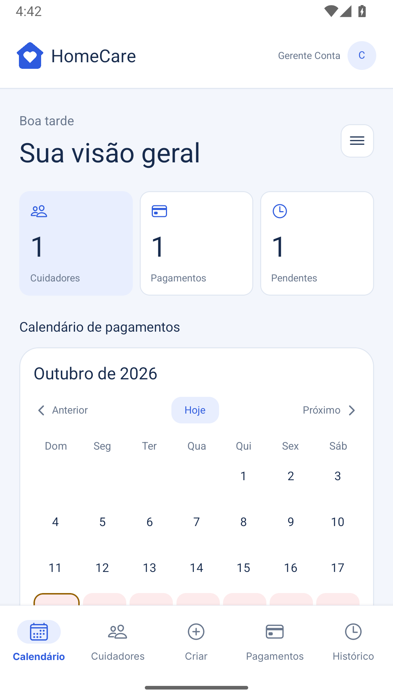

# HomeCare

O **HomeCare** é um aplicativo para organizar a rotina de cuidados domiciliares.
Reúne casas, cuidadores, escalas de plantões e registros de pagamentos em um só lugar.
Permite compartilhar a gestão da casa e acompanhar pagamentos pendentes e históricos, sem realizar transferências bancárias.
Desenvolvido com **React Native, Expo e TypeScript**, usa **Firebase Authentication e Cloud Firestore** para autenticação e armazenamento de dados.
A interface utiliza **NativeWind**, com navegação via **React Navigation**.

## Telas do app

Capturas reais do aplicativo Android com dados fictícios de demonstração.

| Calendário | Cuidadores | Pagamentos |
| :---: | :---: | :---: |
|  |  |  |
