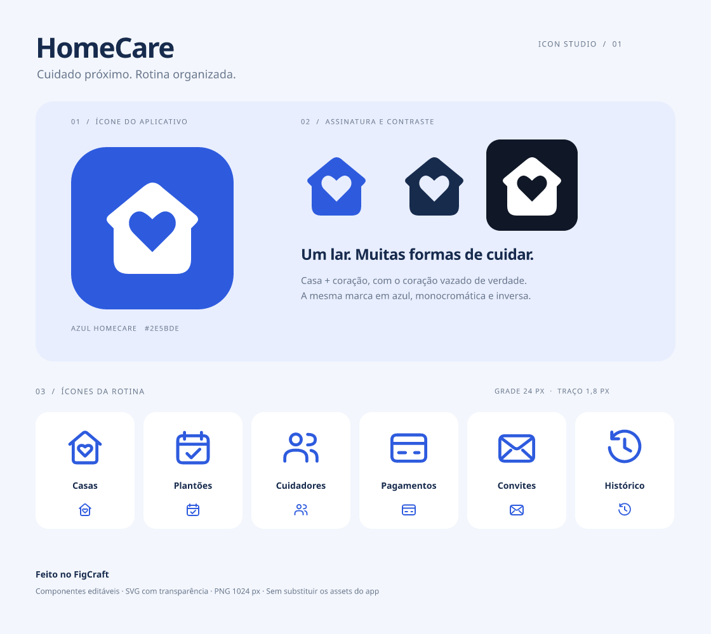

# HomeCare · Icon Studio

Proposta vetorial criada no FigCraft, mantendo a identidade **casa + coração** e o azul `#2E5BDE` de `src/theme/palette.ts`. Os seis ícones de interface são desenhos próprios de contorno; não são cópias ou exports da biblioteca Ionicons usada no app.

Este diretório é um pacote de design independente: **nenhum asset ativo, configuração nativa ou tela do aplicativo foi substituído**.

## Arquivos

- `homecare-icons.figcraft`: fonte editável, com dez componentes, seis instâncias em tamanho real e três estilos de cor.
- `homecare-icon-board.png`: prancha de apresentação, 1120 × 1000 px, com exemplos ampliados e em tamanho real.
- `homecare-app-icon.svg`: proposta de ícone em 256 × 256 unidades.
- `homecare-app-icon.png`: versão rasterizada em 1024 × 1024 px.
- `homecare-mark-color.svg`: marca azul com fundo transparente.
- `homecare-mark-mono.svg`: marca em `#172B4D`, com fundo transparente.
- `homecare-mark-inverse.svg`: marca branca com fundo transparente, para fundos escuros.
- `homecare-houses.svg`: casas.
- `homecare-shifts.svg`: plantões.
- `homecare-caregivers.svg`: cuidadores.
- `homecare-payments.svg`: pagamentos.
- `homecare-invitations.svg`: convites.
- `homecare-history.svg`: histórico.

Os seis SVGs de interface têm `viewBox="0 0 24 24"`, traço de 1,8 px e pontas/junções arredondadas. O coração das marcas é um recorte transparente no vetor, não uma forma pintada da cor do fundo.

O ícone do aplicativo inclui cantos arredondados **para apresentação**. Não é um conjunto de assets nativos pronto para substituir o ícone do launcher: uma integração posterior deve preparar e validar as camadas adaptativas/monocromáticas do Android e os arquivos exigidos pelo Expo.

## Edição e exportação no FigCraft

Abra `homecare-icons.figcraft`. A prancha está à esquerda; os seis componentes mestres de 24 × 24 px estão à direita. Os exemplos pequenos da prancha são instâncias desses componentes; os exemplos ampliados são cópias vetoriais independentes.

Na exportação via MCP, use `includeBoundingBox: true` para manter a caixa exata de 24 × 24 px. A exportação padrão observada acrescentou margem aos traços. Não altere o `viewBox` manualmente sem ajustar a geometria.

A ampliação de instâncias observada durante o teste não preservou a geometria proporcional após reabrir o arquivo. Por isso, os exemplos ampliados foram desvinculados e tiveram a geometria redimensionada explicitamente; os componentes mestres e as instâncias de 24 px foram preservados.

## Validação

- Criação/edição de vetores, componentes, instâncias, estilos de cor e operações em lote no FigCraft.
- Desfazer/refazer, salvar e reabrir o arquivo editável.
- Inspeção visual da prancha após reabertura.
- Parsing XML e renderização independente dos dez SVGs com `rsvg-convert`.
- Conferência da grade de 24 px, das margens dos traços e da transparência do coração e do fundo nas três marcas.
- Conferência das dimensões dos dois PNGs.

Não foi realizado teste visual no aplicativo Android, pois este pacote não foi integrado ao app. Nenhum dispositivo foi utilizado e nenhum build nativo foi reutilizado ou recompilado.
